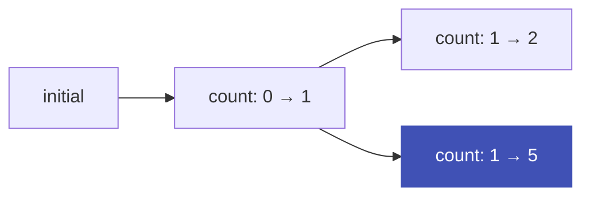

# How the history works

A history is a tree of the states you recorded. You can move to any of them.

The highlighted node is the current node. Here the count went to 1, then to 2.
You went back to 1 and changed it to 5. The 2 stays on its own branch.

## Nodes

A node is one recorded state, such as `{"count": 1}`. Each node knows its
parent and its children. The first node is the root.

## The current node

The history always has one current node. It matches what the widget shows now.

- `undo` moves the current node to its parent.
- `redo` moves it to the newest child.
- `go_to` moves it to any node.

The widget takes the values of the node you move to.

## Branches

Change the widget after an undo, and the history adds a new node under the
current one. This starts a branch. The nodes of the earlier branch stay, and
you can `go_to` them.

## Labels

Each node has a label. A new node gets a label from what changed, such as
`count: 1 → 2`. You can rename any node, for example `before tuning`.

## Without widgets

To use the history without widgets, see [History without widgets](core.md).
