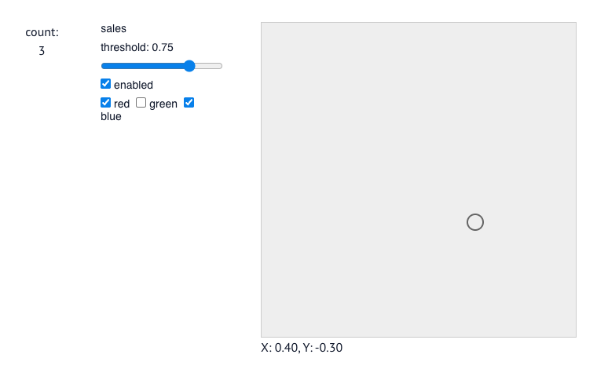
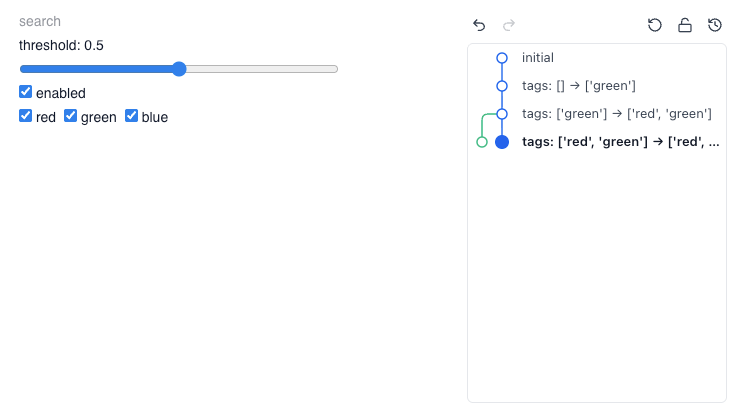

# Examples

Runnable marimo notebooks are in the
[examples folder](https://github.com/kirangadhave/trrackpy/tree/main/examples)
of the repository.

--8<-- "examples/README.md:widgets"

## Run one

Clone the repository, then from its root:

```sh
uv sync
uv run marimo edit examples/persisted/files.py
```

## Persisted

--8<-- "examples/README.md:persisted"



## Trrackable

--8<-- "examples/README.md:trrackable"


