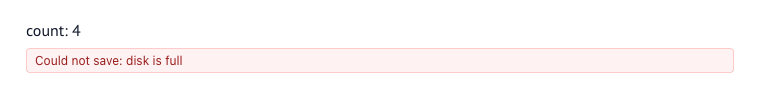

# Persisted

`Persisted` saves a widget's state and restores it the next time it loads.

```python
from trrack_widget import JsonFileStore, Persisted

persisted = Persisted(counter, store=JsonFileStore("state.json"))
persisted                  # shows the counter
```

Change the widget, restart the kernel, and run the cell again. The widget
comes back as you left it.

Try it here. Click the counter, then make a new widget from the saved file:

<iframe class="live-example" src="live/persisted/" title="Live Persisted example" height="400" loading="lazy"></iframe>

## What gets saved

By default, `Persisted` saves the widget's public synced traits. Pass names to
save some of them only:

```python
Persisted(slider, ["x", "y"], store=JsonFileStore("slider.json"))
```

## Read and change the state

```python
persisted.state            # the current values, as a dict
persisted.target           # the wrapped widget
persisted.target.count = 3 # change a value, and it saves
```

## Start over

`reset()` puts the widget back to the values it started with, and saves them.

```python
persisted.reset()
```

## When the state is saved

A change reaches the store about 150 ms later, and a burst of changes shares
one save. Call `save()` to save now.

!!! note "Assign to save"

    `widget.tags = [...]` saves. `widget.tags.append(...)` changes the list in
    place, which the widget cannot see. Call `save()` after it.

## When a save fails

The error appears under the widget, and the widget keeps working. The error
clears after the next save that works.



`save()` raises the error, so you can handle it in code.

## When a saved value does not fit

A saved value that the widget rejects is skipped. The widget keeps its own
value for that trait, and a message under the widget names the trait.

## Run the cell again

A new `Persisted` on the same widget takes over from the earlier one, so a
change saves once. To stop saving, call `close()`.

## Choose a store

See [Stores](stores.md) for the built-in file store and how to write your own.
