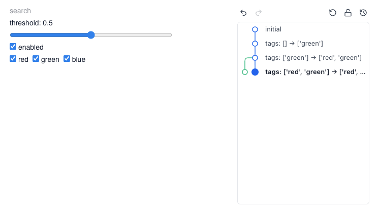

# Quickstart

Wrap a widget, change it, and go back.

## Open a notebook

=== "marimo"

    ```sh
    uv run --with marimo --with trrack-widget marimo edit quickstart.py
    ```

=== "Jupyter"

    ```sh
    uv run --with jupyterlab --with trrack-widget jupyter lab
    ```

To add the package to a project, see [Install](install.md).

## Run it

Paste this into a cell and run it:

```python
--8<-- "docs/live/trrackable.py:example"
```

The widget appears under the cell.

## Try it



1. Click the counter a few times.
2. Click undo. The count goes back one step.
3. Click the counter again. A new branch appears in the history graph.

The earlier branch stays in the graph. Click any node to jump to it.

## Keep the state

Replace the last line with `Persisted` and a store:

```python
from trrack_widget import JsonFileStore, Persisted

Persisted(Counter(), store=JsonFileStore("state.json"))
```

Click the counter, restart the kernel, and run the cell again. The count
comes back. The state is in `state.json`.

## Next steps

- [Persisted](persisted.md): save and restore a widget.
- [Trrackable](trrackable.md): record, undo, redo, and branch.
- [Stores](stores.md): choose where the state lives.
- [How the history works](concepts.md): nodes, branches, and the current node.
