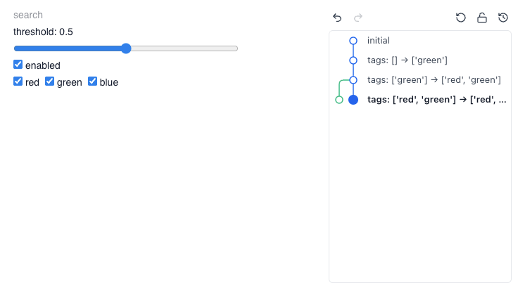

# Trrackable

`Trrackable` records every change to a widget as a history you can undo, redo,
and branch.

```python
from trrack_widget import Trrackable

tracked = Trrackable(counter)
tracked                    # shows the counter and its history
```



## Navigate

Use the controls next to the widget, or call the same actions from Python:

```python
tracked.undo()
tracked.redo()
tracked.go_to(node_id)          # jump to any node
tracked.label("before tuning")  # name the current node
```

Going back and then changing the widget starts a new branch. The earlier
branch stays in the history.

## Show and hide the controls

The controls are a row of buttons and the history graph. Pass `buttons` and
`graph` to choose which ones show:

```python
Trrackable(counter, graph=False)                  # buttons only
Trrackable(counter, buttons=False, graph=False)   # just the widget
```

The History button in the row shows and hides the graph. You can do the same
from Python:

```python
tracked.graph = True
```

`tracked.undo()` and the other actions work with the controls hidden.

## Resize the graph

Hover over the graph and drag the handle on its left edge. Click the lock
button to keep the width.

In a narrow notebook, the controls move below the widget.

## Record less

A slider or a text field changes many times in a second. `debounce_ms` records
a burst of changes as one node:

```python
Trrackable(slider, debounce_ms=300)
```

Pass trait names to record some of them only:

```python
Trrackable(slider, ["x", "y"])
```

## Name the nodes

Each node gets a label from what changed, such as `count: 1 → 2`. Pass
`label_formatter` to write your own from the old and new values:

```python
Trrackable(
    slider,
    label_formatter=lambda old, new: f"x = {new['x']:.2f}",
)
```

## Keep the history

Pass a store to keep the history between sessions:

```python
from trrack_widget import JsonFileStore

Trrackable(counter, store=JsonFileStore("history.json"))
```

A save runs about 150 ms after a change. If a save fails, the error appears
under the widget, and the widget keeps working.

`Trrackable` can open a store that [`Persisted`](persisted.md) saved. The saved
state becomes the first node of a new history.

See [Stores](stores.md) for how to write your own store.
